# Biomedical AI — Comprehensive Codebase Documentation

## 1. Executive Summary

**Biomedical AI** is an end-to-end, modular biomedical computational pipeline designed for disease-target discovery, literature-augmented validation, therapeutic target prioritization, and natural compound candidate discovery and verification. 

The system bridges high-confidence structured knowledge bases with unstructured scientific literature and chemical registries:
1. Normalizes the disease name across global biomedical ontologies (MONDO, EFO, DOID, MeSH) using the EMBL-EBI Ontology Lookup Service (OLS4).
2. Retrieves disease-target associations from the Open Targets Platform GraphQL API.
3. Automatically constructs PubMed search queries and retrieves scientific literature for candidate targets across PubMed, Europe PMC, and Open Targets.
4. Processes, chunks, embeds, indexes, and reranks literature passages using a Retrieval-Augmented Generation (RAG) architecture powered by FAISS, Sentence Transformers, and Cross-Encoders.
5. Extracts structured biological assertions (relations, evidence types, strengths, directions, confidence) from retrieved passages using rule-based Natural Language Processing.
6. Constructs a multi-modal Knowledge/Evidence Graph relating diseases, drug targets, published papers, and evidence claims.
7. Fuses structured Open Targets scores with literature evidence into a combined quantitative score.
8. Prioritizes and ranks candidate targets for downstream experimental or clinical investigation.
9. Discovers bioactive and natural compounds via dual routes: Route A (disease literature) and Route B (protein target ChEMBL bioactivities).
10. Verifies chemical identity (PubChem CID, canonical SMILES, standard InChIKey), distinguishes natural vs. synthetic origin, and retains full provenance audit trails.

---

## 2. High-Level Architecture Diagram

```mermaid
flowchart TD
    subgraph S1["1. Disease Normalization"]
        Input["User Disease Input (e.g., 'Type 2 diabetes')"] --> DN["DiseaseNormalizer"]
        DN --> OLS["OLS4 Client (EMBL-EBI)"]
        OLS --> Scorer["Candidate Scorer"]
        Scorer --> DC["DiseaseConcept (Canonical ID, EFO/MONDO, Synonyms)"]
    end

    subgraph S2["2. Structured Target Retrieval"]
        DC -->|EFO / MONDO ID| SR["StructuredRetriever"]
        SR --> OT["Open Targets GraphQL API"]
        OT --> Dedup["Deduplication & Score Filtering"]
        Dedup --> Targets["Target Candidates (Ensembl ID, Symbol, Score, Datatype Breakdown)"]
    end

    subgraph S3["3. Literature Retrieval"]
        Targets -->|Target Symbols| LR["LiteratureRetriever"]
        DC -->|Disease Name| LR
        LR --> QB["LiteratureQueryBuilder"]
        QB --> PM["PubMedClient (NCBI Entrez eSearch & eFetch)"]
        PM --> Papers["Parsed Paper Records (PMID, Title, Abstract, Journal, Authors)"]
    end

    subgraph S4["4. Biomedical RAG Pipeline"]
        Papers --> DP["DocumentProcessor"]
        DP --> Chunker["TextChunker (Sliding Window)"]
        Chunker --> Embedder["TextEmbedder (all-MiniLM-L6-v2)"]
        Embedder --> VS["FAISS VectorStore (IndexFlatL2)"]
        Query["Target Evidence Query"] --> Ret["SemanticRetriever"]
        VS --> Ret
        Ret --> Rerank["CrossEncoder Reranker (ms-marco-MiniLM-L-6-v2)"]
        Rerank --> Passages["Top Relevant Chunks / Passages"]
    end

    subgraph S5["5. Evidence Extraction"]
        Passages --> EE["EvidenceExtractor"]
        EE --> SentSplit["Sentence Splitter & Context Builder"]
        SentSplit --> Rules["Rule-Based Classifiers (Type, Relation, Strength, Direction)"]
        Rules --> Conf["Confidence Scoring & Deduplication"]
        Conf --> EvItems["EvidenceItem Claims"]
    end

    subgraph S6["6. Evidence Graph"]
        EvItems --> EGB["EvidenceGraphBuilder"]
        Targets --> EGB
        DC --> EGB
        Papers --> EGB
        EGB --> EG["EvidenceGraph (Diseases, Targets, Papers, Evidence Nodes & Edges)"]
    end

    subgraph S7["7. Evidence Fusion & Prioritization"]
        EG --> EF["EvidenceFusion"]
        Targets --> EF
        EF --> LitScore["Calculate Literature Score (Strong/Moderate/Weak Weights)"]
        LitScore --> FuseFormula["Weighted Linear Fusion (Structured + Literature)"]
        FuseFormula --> TFR["TargetFusionResult (Fused Score)"]
        TFR --> TP["TargetPrioritizer"]
        TP --> PrioritizedTargets["Prioritized Targets (Ranked 1..N)"]
    end

    subgraph S8["8. Natural Compound Candidate Retrieval (Step 6)"]
        DC -->|Disease Name| RouteA["Route A: Disease -> Natural Literature Mining"]
        PrioritizedTargets -->|Protein Symbols| RouteB["Route B: Protein -> ChEMBL Bioactivity & PubMed"]
        RouteA --> MergeCompounds["Merge & Deduplication (InChIKey / ChEMBL ID)"]
        RouteB --> MergeCompounds
        MergeCompounds --> RawCandidates["Candidate Compounds (Dual-Route Flagged)"]
    end

    subgraph S9["9. Compound Identity & Origin Verification (Step 7)"]
        RawCandidates --> CV["CompoundVerifier"]
        CV --> PubChem["PubChem PUG REST Client (CID, SMILES, InChIKey, Synonyms)"]
        CV --> Classifier["NaturalOriginClassifier (Curated Registry & Rules)"]
        Classifier --> OriginStatus["Natural / Natural Derivative / Synthetic / Unverified"]
        PubChem --> VerifiedID["Standardized Chemical Descriptors"]
        OriginStatus --> VC["Verified Compounds + Retained Provenance"]
        VerifiedID --> VC
    end
```



---

## 3. Detailed Component Analysis

### 3.1. `disease_normalizer/`
Normalizes uncurated disease terms into controlled ontology concepts.
- **`models.py`**: `DiseaseInput`, `DiseaseIdentifiers`, `DiseaseSynonyms`, `DiseaseCandidate`, `NormalizationMetadata`, `DiseaseConcept`.
- **`preprocess.py`**: String normalization, whitespace collapsing, hyphen/underscore normalization.
- **`ols.py`**: Connects to EMBL-EBI OLS4 select API (`mondo`, `doid`, `efo`, `mesh`).
- **`resolver.py`**: Multi-tier scoring: exact label (1.0), exact synonym (0.95), partial label (0.85), partial synonym (0.80).
- **`normalizer.py`**: Orchestrates multi-ontology resolution and cross-mapping.

---

### 3.2. `structured_retriever/`
Retrieves known disease-target associations from Open Targets Platform.
- **`model.py`**: `TargetEvidence`, `TargetCandidate`, `StructuredRetrievalResult`.
- **`open_targets.py`**: Open Targets GraphQL client querying `associatedTargets`.
- **`retriever.py`**: Pagination, datatype score parsing, Ensembl deduplication, and score threshold filtering.

---

### 3.3. `literature_retriever/`
Harvests scientific literature across NCBI PubMed, EMBL-EBI Europe PMC, and Open Targets.
- **`models.py`**: `Paper`, `LiteratureRetrievalResult`, `BatchLiteratureResult`.
- **`query_builder.py`**: Generates `"{disease_name}" AND {target_symbol}` queries.
- **`pubmed.py`**: NCBI Entrez E-Utilities (`esearch` + `efetch` + XML parsing).
- **`europe_pmc.py`**: Europe PMC REST client for peer-reviewed papers and preprints.
- **`open_targets_literature.py`**: Extracts text-mined PMIDs from Open Targets GraphQL API.
- **`retriever.py`**: Batch multi-source retrieval with PMID/DOI deduplication.

---

### 3.4. `biomedical_rag/`
Semantic retrieval and neural reranking of scientific publications.
- **`models.py`**: `RAGDocument`, `RAGChunk`, `RerankedResult`.
- **`document_processor.py`**: Maps `Paper` to `RAGDocument`.
- **`chunker.py`**: Character-level sliding window chunker.
- **`embedder.py`**: `SentenceTransformer("all-MiniLM-L6-v2")` 384-dimensional dense vectors.
- **`vector_store.py`**: In-memory FAISS `IndexFlatL2` Euclidean distance index.
- **`retriever.py`**: Semantic retriever querying target-disease relationships.
- **`reranker.py`**: `CrossEncoder("cross-encoder/ms-marco-MiniLM-L-6-v2")`.

---

### 3.5. `evidence_extractor/`
Extracts structured assertions from text chunks or abstracts.
- **`models.py`**: `EvidenceItem`, `EvidenceExtractionResult`.
- **`rules.py`**: Regex target detection (`\bSYMBOL\b`), evidence type classification (`protein_interaction`, `genetic_association`, `drug_target`, `gene_expression`, `clinical`, `animal_model`, `experimental`), relation classification (`drug_target_of`, `associated_with`, `no_association`), strength, and direction.
- **`extractor.py`**: Context sentence sliding window and confidence calculator.

---

### 3.6. `evidence_graph/`
Builds an in-memory heterogeneous knowledge graph.
- **`models.py`**: `DiseaseNode`, `TargetNode`, `PaperNode`, `EvidenceNode`, `EvidenceEdge`, `EvidenceGraph`.
- **`graph.py`**: `EvidenceGraphBuilder` constructing multi-hop edges (`Target --[supported_by]--> Evidence`, `Evidence --[reported_in]--> PMID`, `Disease --[relation]--> Target`).

---

### 3.7. `evidence_fusion/`
Combines structured database scores with literature evidence into a unified score.
- **`models.py`**: `TargetFusionInput`, `TargetFusionResult`.
- **`fusion.py`**:
  $$\text{Literature Score} = \min\left(1.0, \frac{\text{strong} \times 1.0 + \text{moderate} \times 0.6 + \text{weak} \times 0.3}{\text{total\_evidence\_count}}\right)$$
  $$\text{Fused Score} = (\text{structured\_score} \times 0.60) + (\text{literature\_score} \times 0.40)$$

---

### 3.8. `target_prioritization/`
Selects and ranks top candidate targets.
- **`models.py`**: `PrioritizedTarget`, `TargetPrioritizationResult`.
- **`prioritizer.py`**: Sorts descending by fused score, assigns 1-based ranks, and outputs top-$N$ candidates.

---

### 3.9. `compound_retriever/` (Step 6)
Discovers candidate natural and bioactive compounds via dual independent routes:
- **`models.py`**: `BioactivityRecord`, `TargetRelation`, `CompoundCandidate`, `CompoundRetrievalResult`.
- **`chembl_client.py`**: Queries ChEMBL REST API (`/target.json`, `/activity.json`, `/molecule.json`) for binding and functional assays (`IC50`, `Ki`, `Kd`, `EC50`) against prioritized target proteins.
- **`pubmed_compound.py`**: Mines PubMed for disease-specific natural product literature.
- **`retriever.py`**: Orchestrates Route A (Disease -> Natural Lit) and Route B (Protein -> ChEMBL Bioactivities + Protein PubMed), merges by InChIKey/ChEMBL ID/Name, and flags **Dual-Route Hits**.

---

### 3.10. `compound_verifier/` (Step 7)
Chemically standardizes candidate compounds, retrieves authoritative chemical descriptors, distinguishes natural vs. synthetic origin, and retains comprehensive audit provenance:
- **`models.py`**:
  - `NaturalOriginStatus`: Enum (`NATURAL`, `NATURAL_DERIVATIVE`, `SYNTHETIC`, `UNVERIFIED`).
  - `CompoundIdentity`: Standardized descriptors (`name`, `iupac_name`, `pubchem_cid`, `inchikey`, `canonical_smiles`, `isomeric_smiles`, `molecular_formula`, `molecular_weight`, `synonyms`).
  - `NaturalOriginVerification`: Assessment record (`status`, `is_natural`, `confidence`, `natural_product_class`, `subclass`, `determination_method`, `evidence_sources`, `notes`).
  - `VerifiedCompound`: Complete unified representation combining identity, origin verification, Step 6 target relations, bioactivities, citations, and full provenance.
  - `CompoundVerificationBatchResult`: Aggregated batch results with category breakdown counts.
- **`pubchem_client.py`**:
  - NCBI PubChem PUG REST API client with request rate throttling (200ms delay) and in-memory LRU caching.
  - Multi-strategy resolver: resolves by PubChem CID, by Standard InChIKey, by compound Name, or by SMILES.
  - Validates InChIKey syntax (14-10-1 format).
  - Fetches authoritative chemical synonyms and trade names.
- **`natural_classifier.py`**:
  - Multi-tier classification engine:
    1. *Curated Phytochemical Taxonomy*: Comprehensive registry covering Flavonoids, Polyphenols, Alkaloids, Terpenoids, Anthraquinones, Lignans, Stilbenes, Withanolides, Carotenoids, and Organosulfur compounds with specific subclasses and botanical origins.
    2. *Semi-Synthetic / Natural Derivatives*: Tracks natural scaffold derivatives (Aspirin, Dihydroartemisinin, Artemether, Docetaxel, Pravastatin, Simvastatin).
    3. *Curated Synthetic Registry*: Identifies synthetic pharmaceuticals (Metformin, Rosiglitazone, Glimepiride, Sitagliptin, Dapagliflozin, Imatinib, Ibuprofen, etc.).
    4. *Database Cross-Verification*: Incorporates ChEMBL `natural_product` flags and molecule type annotations.
- **`verifier.py`**:
  - `CompoundVerifier`: Master orchestrator for single and batch compound verification.
  - Standardizes compound IDs (`CID:xxx`, `CHEMBLxxx`, or `LIT:xxx`).
  - Merges and retains all Step 6 retrieval provenance, PMIDs, snippets, and target relations.
  - Sorts verified compounds prioritizing verified natural products and dual-route hits.

---

## 4. Test Suite and Verification

| Test Script | Scope | Purpose |
|---|---|---|
| `test_disease_normalizer.py` | Integration / Live API | Queries OLS API with disease terms ("Type 2 diabetes", "Alzheimer"). |
| `test_structured_retriever_unit.py` | Unit | Tests target model creation, evidence parsing, and deduplication. |
| `structured_retriever/test_structured_retriever.py` | Integration / Live API | Queries Open Targets API for MONDO:0005148. |
| `test_query_builder_unit.py` | Unit | Tests PubMed query string generation. |
| `test_literature_retriever_unit.py` | Unit | Tests `Paper` model instantiation and input validation. |
| `test_rag_pipeline.py` | Component Integration | Semantic search and cross-encoder reranking. |
| `test_evidence_extractor.py` | Component Integration | Biological assertion extraction from abstracts. |
| `test_evidence_graph.py` | Component Integration | Heterogeneous graph assembly. |
| `test_evidence_fusion.py` | Unit | Mathematical score fusion unit test. |
| `test_evidence_fusion_graph.py` | Unit | Graph-to-fusion unit test. |
| `test_evidence_fusion_integration.py` | Full Pipeline Integration | Executes Steps 1 through 5 end-to-end. |
| `test_target_prioritization.py` | Unit | Verifies rank assignment and sorting on candidate targets. |
| `test_compound_retriever.py` | Component & Live API | Tests Step 6 dual-route natural compound retrieval (ChEMBL + PubMed). |
| `test_compound_verifier.py` | Component & Live API | Tests Step 7 PubChem CID resolution, InChIKey validation, natural vs. synthetic classification, and provenance. |

---

## 5. Repository File Inventory

```
Disease-Compound-Analysis/
├── README.md                                # Project overview, setup, and test commands
├── CodeBase.md                              # Comprehensive architectural codebase documentation
├── requirements.txt                         # Python dependencies
├── server.py                                # Local HTTP server exposing REST APIs + frontend
├── pipeline.py                              # End-to-end target discovery pipeline orchestrator
│
├── disease_normalizer/                      # Step 1: Disease normalization & ontology resolution
│   ├── __init__.py                          # Exports DiseaseNormalizer
│   ├── models.py                            # DiseaseInput, DiseaseConcept, DiseaseIdentifiers
│   ├── preprocess.py                        # String cleaning & normalization
│   ├── ols.py                               # EMBL-EBI OLS4 API client
│   ├── resolver.py                          # Scoring & candidate evaluation
│   ├── normalizer.py                        # Multi-ontology search & canonical concept resolution
│   └── suggester.py                         # Autocomplete and spelling suggestion engine
│
├── structured_retriever/                    # Step 2: Open Targets association retrieval
│   ├── __init__.py                          # Exports StructuredRetriever
│   ├── model.py                             # TargetCandidate, TargetEvidence, StructuredRetrievalResult
│   ├── open_targets.py                      # Open Targets GraphQL API client
│   └── retriever.py                         # Pagination, deduplication, filtering, scoring
│
├── literature_retriever/                    # Step 3: Multi-source literature harvesting
│   ├── __init__.py                          # Module init
│   ├── models.py                            # Paper, LiteratureRetrievalResult, BatchLiteratureResult
│   ├── query_builder.py                     # PubMed query syntax builder
│   ├── pubmed.py                            # NCBI Entrez E-Utilities client & XML parser
│   ├── europe_pmc.py                        # EMBL-EBI Europe PMC REST client
│   ├── open_targets_literature.py           # Open Targets text-mined literature client
│   └── retriever.py                         # Single & batch multi-source literature retrieval
│
├── biomedical_rag/                          # Step 3-4: Vector indexing & semantic reranking
│   ├── __init__.py                          # Module init
│   ├── models.py                            # RAGDocument, RAGChunk, RerankedResult
│   ├── document_processor.py                # Converts Paper to RAGDocument
│   ├── chunker.py                           # Sliding window character chunker
│   ├── embedder.py                          # SentenceTransformer embedder (all-MiniLM-L6-v2)
│   ├── vector_store.py                      # In-memory FAISS IndexFlatL2 store
│   ├── retriever.py                         # Semantic dense vector retriever
│   ├── reranker.py                          # CrossEncoder reranker (ms-marco-MiniLM-L-6-v2)
│   └── rag_pipeline.py                      # Unified RAG coordinator
│
├── evidence_extractor/                      # Step 4: Rule-based biological assertion extraction
│   ├── __init__.py                          # Exports EvidenceExtractor, EvidenceItem
│   ├── models.py                            # EvidenceItem, EvidenceExtractionResult
│   ├── rules.py                             # Regex, entity detection, relation & strength rules
│   └── extractor.py                         # Sentence sliding context extractor & confidence calculator
│
├── evidence_graph/                          # Step 4-5: Heterogeneous evidence graph
│   ├── __init__.py                          # Exports nodes, edges, EvidenceGraphBuilder
│   ├── models.py                            # DiseaseNode, TargetNode, PaperNode, EvidenceNode, EvidenceEdge
│   └── graph.py                             # Graph builder assembling multi-hop relationships
│
├── evidence_fusion/                         # Step 5: Score fusion engine
│   ├── __init__.py                          # Exports EvidenceFusion, TargetFusionInput, TargetFusionResult
│   ├── models.py                            # Input & result data models
│   └── fusion.py                            # Weighted multi-modal evidence fusion engine
│
├── target_prioritization/                   # Step 5: Target sorting & selection
│   ├── __init__.py                          # Exports TargetPrioritizer, PrioritizedTarget
│   ├── models.py                            # PrioritizedTarget, TargetPrioritizationResult
│   └── prioritizer.py                       # Sorting, top-N slicing, ranking
│
├── compound_retriever/                      # Step 6: Natural compound candidate retrieval
│   ├── __init__.py                          # Exports NaturalCompoundRetriever
│   ├── models.py                            # BioactivityRecord, TargetRelation, CompoundCandidate
│   ├── chembl_client.py                     # EMBL-EBI ChEMBL REST API client
│   ├── pubmed_compound.py                   # PubMed natural compound mining client
│   └── retriever.py                         # Route A + Route B orchestrator & deduplication
│
├── compound_verifier/                       # Step 7: Compound identity & natural-origin verification
│   ├── __init__.py                          # Exports CompoundVerifier, PubChemClient, models
│   ├── models.py                            # CompoundIdentity, NaturalOriginVerification, VerifiedCompound
│   ├── pubchem_client.py                    # NCBI PubChem PUG REST API client with caching
│   ├── natural_classifier.py                # Phytochemical taxonomy & synthetic drug classifier
│   └── verifier.py                          # Single & batch verification and provenance manager
│
├── frontend/                                # Interactive browser application
│   ├── index.html                           # App layout, stepper, targets and compounds tabs
│   ├── style.css                            # Modern responsive UI design
│   └── app.js                               # Interactive frontend logic and API integration
│
├── test_disease_normalizer.py               # Step 1 test
├── test_structured_retriever_unit.py        # Step 2 test
├── test_query_builder_unit.py               # Step 3 test
├── test_literature_retriever_unit.py        # Step 3 test
├── test_rag_pipeline.py                     # Step 3-4 test
├── test_evidence_extractor.py               # Step 4 test
├── test_evidence_graph.py                   # Step 4-5 test
├── test_evidence_fusion.py                  # Step 5 test
├── test_evidence_fusion_graph.py            # Step 5 test
├── test_evidence_fusion_integration.py      # Steps 1–5 end-to-end integration test
├── test_target_prioritization.py            # Step 5 ranking test
├── test_compound_retriever.py               # Step 6 test (Route A + Route B)
└── test_compound_verifier.py                # Step 7 test (PubChem + Origin verification)
```
